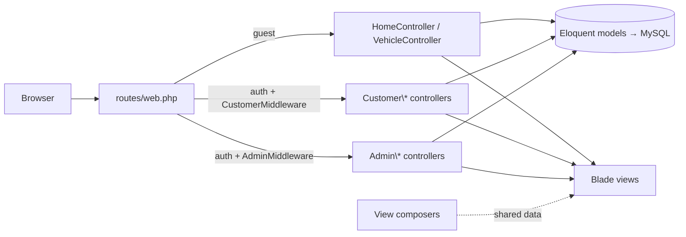
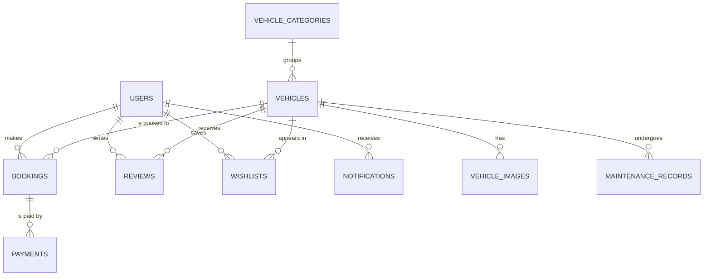
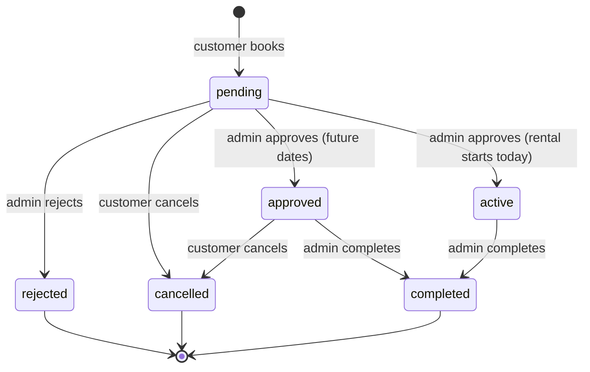

<div align="center">

# 🚗 DriveEase

### Vehicle Rental Management System (VRMS)

A full-stack car rental platform built with **Laravel 12**. Customers browse, compare, save and book vehicles; admins manage the fleet, bookings, payments, maintenance, reviews and business reports from a dedicated dashboard.


[Overview](#-overview) · [Features](#-features) · [Design System](#-design-system--ui) · [Architecture](#-architecture) · [Getting Started](#-getting-started) · [Testing](#-testing) · [Troubleshooting](#-troubleshooting)

</div>

---

## 📖 Overview

DriveEase is a complete vehicle rental management system with three distinct experiences that share one visual language:

| Role | Access | Purpose |
|------|--------|---------|
| **Guest** | Public pages | Search, filter and compare vehicles, read reviews, contact support |
| **Customer** | `/customer/*` | Book vehicles, manage profile, wishlist, invoices, reviews and notifications |
| **Admin** | `/admin/*` | Manage fleet, categories, bookings, payments, customers, maintenance, reviews and reports |

- Prices are shown in **TK (BDT)**; a **5 % service tax** is added to every booking.
- The seeded dataset ships with **51 vehicles across 8 categories**, 20 customers, an admin, bookings, payments, maintenance records and reviews, so the app is fully browsable right after installation.

---

## ✨ Features

### 👤 Guest (public site)
- Home page with hero search, live fleet statistics, category tiles, a "How It Works" guide, featured vehicles, testimonials and a call-to-action
- **Vehicle catalogue** with keyword search, category / fuel / transmission / price filters, sorting and pagination
- **Vehicle detail** page with image gallery, full specifications, a daily / weekly / monthly cost calculator, reviews and related vehicles
- **Side-by-side comparison** of up to 4 vehicles
- **Live navbar search** with instant suggestions and keyboard navigation (↑ ↓ Enter Esc)
- About, Contact (with contact form), FAQ, Privacy and Terms pages
- Newsletter subscription from the footer
- Registration, login and **forgot / reset password** flows (rate-limited)

### 🧍 Customer
- Personal dashboard with a welcome banner, booking statistics, recent bookings and notifications
- Create bookings: choose pickup / return dates and the total (rental + 5 % tax) is calculated automatically
- Booking lifecycle: view status, cancel (while pending or approved), print a **downloadable invoice**
- **Wishlist**: save vehicles with the heart button on any vehicle card. It toggles instantly (AJAX, no page reload) and shows which vehicles are already saved
- Profile editing (with avatar) and password change
- Post reviews on vehicles you have rented
- **Notification centre** in the navbar with an unread badge

### 🛡️ Admin
- KPI dashboard: fleet, customers, bookings, monthly revenue, a 12-month revenue chart and a booking-status chart (Chart.js)
- Fleet management: full CRUD for vehicles, images, pricing and availability
- Vehicle **category** management
- Booking workflow: **approve** (with date-conflict detection), **reject** (with reason) and **complete**
- Payment tracking and status updates
- Customer management with account activation / deactivation
- Maintenance records (scheduled → in progress → completed)
- Review moderation: approve, reject, delete
- Reports: **revenue, vehicle utilisation, customers, maintenance**, each with **PDF export** (dompdf)
- Sidebar badges for pending bookings and pending reviews

---

## 🎨 Design System & UI

All three areas (public site, customer area and admin panel) load a single stylesheet, [`public/css/app.css`](public/css/app.css), so colours, spacing, components and interactions stay consistent.

### Tokens
Defined as CSS custom properties on `:root`:

| Token group | Examples |
|-------------|----------|
| Brand | `--primary #2563eb`, `--primary-dark`, `--accent #e11d48` |
| Neutrals | `--dark-950 … --dark-700`, `--gray-600 … --gray-50` |
| Shape | `--radius-sm` → `--radius-xl`, `--radius-pill` |
| Elevation | `--shadow-xs` → `--shadow-xl`, `--shadow-card`, `--shadow-card-hover` |
| Typography | **Plus Jakarta Sans** (Google Fonts) |

### Components

| Component | Class(es) | Used for |
|-----------|-----------|----------|
| Vehicle card | `.vehicle-card`, `.vehicle-card-img-wrap`, `.spec-pill` | Catalogue, home, wishlist |
| Wishlist button | `.wishlist-btn`, `.wishlist-btn-corner` (+ `.active`) | Heart toggle on vehicle cards |
| Status pill | `.status-pill .status-{success,warning,danger,info,primary,secondary}` | Booking / payment / maintenance status |
| Page hero | `partials/page-hero` + `.page-hero` | Banner with breadcrumb on inner pages |
| Stat tile / card | `.stat-tile` (customer), `.stat-card` (admin) | Dashboard KPIs |
| Content / table card | `.content-card`, `.table-card` | Panels and data tables |
| Empty state | `.empty-state`, `.empty-state-icon` | "No bookings yet"-style messages |
| Feature / category / step | `.feature-box`, `.category-card`, `.step-card` | Home page sections |

Status badges are produced by helpers in [`app/Support/helpers.php`](app/Support/helpers.php) (`booking_status_badge()`, `payment_status_badge()`, `maintenance_status_badge()`), so changing a status style happens in one place.

### Interaction & accessibility
- Sticky, translucent navbar that compacts with a shadow once the page scrolls
- Toast notifications (SweetAlert2) for every success / error flash message
- Scroll-reveal animations (`data-reveal`) and a back-to-top button
- Responsive admin sidebar that becomes an off-canvas drawer below 992 px, with backdrop and <kbd>Esc</kbd> to close
- Skip-to-content link, visible `:focus-visible` rings, `aria-label`s on icon-only buttons
- Headings inherit colour, so text stays readable inside dark sections (heroes, CTA, footer)
- All motion is disabled for users with `prefers-reduced-motion: reduce`
- Layouts checked at phone (375 px), tablet (900 px) and desktop widths with no horizontal scrolling

---

## 🏗 Architecture

### Request flow



### Layouts & partials

| File | Purpose |
|------|---------|
| `layouts/app.blade.php` | Public site shell |
| `layouts/customer.blade.php` | Customer area: public navbar / footer + account sidebar |
| `layouts/admin.blade.php` | Admin shell: dark sidebar, sticky top bar, Chart.js & DataTables |
| `partials/navbar.blade.php` | Shared navbar (search, wishlist, notifications, user menu) |
| `partials/footer.blade.php` | Shared footer (links, newsletter, contact, back-to-top) |
| `partials/scripts.blade.php` | Shared JS: live search, AJAX wishlist, toasts, confirmations, scroll effects |
| `partials/page-hero.blade.php` | Inner-page banner with breadcrumb |

### View composers

| Composer | Views | Shares |
|----------|-------|--------|
| `NotificationComposer` | `layouts.*` | Unread count + latest notifications; admin sidebar pending counts |
| `WishlistComposer` | `home.index`, `home.vehicles`, `home.vehicle-detail` | `$wishlistIds`: the logged-in customer's saved vehicle IDs |

### Data model



Also stored: `contact_messages`, `newsletter_subscriptions` and Laravel's `sessions`, `cache`, `jobs` and `password_reset_tokens` tables.

### Booking lifecycle



Approval is blocked if another **approved / active** booking overlaps the same vehicle and dates.

---

## 🛠 Tech Stack

| Layer | Technologies |
|-------|--------------|
| Backend | Laravel 12, PHP 8.2+, Eloquent ORM, Blade templates |
| Frontend | Bootstrap 5.3, custom design system (`app.css`), Font Awesome 6, SweetAlert2, Chart.js 4, DataTables, vanilla JS |
| Build | Vite 7, laravel-vite-plugin, Tailwind CSS 4 (Vite pipeline) |
| Database | MySQL 8 (MariaDB via XAMPP also works) |
| PDF | barryvdh/laravel-dompdf |
| Testing | PHPUnit 11, Laravel feature tests |
| Tooling | Laravel Pint, Laravel Pail, Laravel Sail, Tinker |

---

## 📂 Project Structure

```
├── app/
│   ├── Http/Controllers/
│   │   ├── Admin/            # Dashboard, vehicles, categories, bookings, payments,
│   │   │                     # customers, maintenance, reviews, reports
│   │   ├── Auth/             # Login, register, forgot / reset password
│   │   ├── Customer/         # Dashboard, bookings, wishlist, profile, reviews
│   │   ├── HomeController.php
│   │   └── VehicleController.php
│   ├── Http/Middleware/      # AdminMiddleware, CustomerMiddleware
│   ├── Models/               # User, Vehicle, VehicleCategory, VehicleImage, Booking,
│   │                         # Payment, Review, Wishlist, MaintenanceRecord, Notification…
│   ├── Providers/            # AppServiceProvider (pagination view, view composers)
│   ├── Support/helpers.php   # Blade helpers (status pills, image / avatar URLs)
│   └── View/Composers/       # NotificationComposer, WishlistComposer
├── database/
│   ├── migrations/           # Schema + performance indexes
│   └── seeders/              # Demo users, categories, vehicles, bookings, reviews…
├── public/
│   ├── css/app.css           # Shared design system
│   └── favicon.svg
├── resources/views/
│   ├── admin/  customer/  auth/  home/
│   ├── layouts/              # app, customer, admin
│   ├── partials/             # navbar, footer, scripts, page-hero
│   └── vendor/pagination/    # Published pagination templates
├── routes/web.php            # All application routes
├── tests/Feature/            # Auth, booking flow, public pages, admin access, wishlist
└── DriveEase_Project_Documentation.pdf
```

---

## 🚀 Getting Started

### Requirements

- PHP **8.2+** with `pdo_mysql`, `mbstring`, `openssl`, `tokenizer`, `xml`, `curl`, `zip`, `gd` (for dompdf)
- Composer 2
- Node.js 18+ and npm
- MySQL 8 / MariaDB 10.4+ (XAMPP works out of the box)

### 1. Clone & install

```bash
git clone https://github.com/Shahriar1290/DriveEase.git
cd DriveEase
composer install
npm install
```

### 2. Configure the environment

```bash
cp .env.example .env
php artisan key:generate
```

Create the database (`CREATE DATABASE vrms;`) and set it in `.env`:

```env
DB_CONNECTION=mysql
DB_HOST=127.0.0.1
DB_PORT=3306
DB_DATABASE=vrms
DB_USERNAME=root
DB_PASSWORD=
```

### 3. Migrate, seed & link storage

```bash
php artisan migrate --seed
php artisan storage:link
```

`storage:link` is required for vehicle images and avatars to display.

### 4. Run

```bash
npm run build          # or: npm run dev
php artisan serve      # → http://localhost:8000
```

### ⚡ One-command setup

```bash
composer setup
```

Runs `composer install` → copies `.env` → `key:generate` → `migrate --force` → `npm install` → `npm run build`.

### 🧑‍💻 Everyday development

```bash
composer dev
```

Starts the web server, queue worker, log tailer (`pail`) and Vite watcher together.

---

## 🔑 Demo Accounts

Created by `php artisan migrate --seed`. The password for every account is **`password`**.

| Role | Email | Lands on |
|------|-------|----------|
| Admin | `admin@vrms.com` | `/admin/dashboard` |
| Customer | `alice@example.com` (plus 19 more, e.g. `bob@example.com`) | `/customer/dashboard` |

> ⚠️ These are demo credentials. Change or remove them before deploying anywhere public.

---

## 🧪 Testing

Feature tests run against a **separate MySQL database**, `vrms_testing`, configured in [`phpunit.xml`](phpunit.xml):

```sql
CREATE DATABASE vrms_testing;
```

Migrate and seed it once. Pass the database name explicitly (see the warning below):

```bash
DB_DATABASE=vrms_testing php artisan migrate:fresh --seed
```

Then run the suite:

```bash
composer test          # clears config cache, then runs php artisan test
# or
php artisan test
```

| File | Coverage |
|------|----------|
| `AuthenticationTest` | Login / registration pages, valid & invalid login, logout |
| `BookingFlowTest` | Booking list / create, guest protection, admin approve / reject |
| `AdminDashboardTest` | Guest redirection, role isolation, admin section access |
| `PublicPagesTest` | Home, vehicles, about, contact, FAQ, forgot-password |
| `WishlistTest` | AJAX wishlist toggle, saved state shared with listing pages, guest defaults |

> ⚠️ **Never run `php artisan migrate:fresh --env=testing`.** There is no `.env.testing` file, so Laravel falls back to `.env` and wipes your **development** database. `phpunit.xml` only switches databases when PHPUnit runs. Always pass `DB_DATABASE=vrms_testing` explicitly as shown above.

> ℹ️ Tests do not use `RefreshDatabase`, so data accumulates in `vrms_testing` across runs. If `admin can approve booking` starts failing with a booking conflict, reseed the testing database with the command above.

---

## 🗺 Key Routes

<details>
<summary><b>Public</b></summary>

```
GET  /                      home
GET  /vehicles              catalogue (filters, sorting, pagination)
GET  /vehicles/search       live-search JSON
GET  /vehicles/compare      comparison (?ids[]=…, max 4)
GET  /vehicles/{slug}       vehicle detail
GET  /about | /contact | /faq | /privacy | /terms
POST /contact               contact form
POST /newsletter            newsletter subscribe
```
</details>

<details>
<summary><b>Auth</b></summary>

```
GET|POST /login                   (throttle 5/min)
GET|POST /register                (throttle 10/min)
POST     /logout
GET|POST /forgot-password         (throttle 3/min)
GET      /reset-password/{token}
POST     /reset-password
```
</details>

<details>
<summary><b>Customer</b>: prefix <code>/customer</code>, middleware <code>auth + CustomerMiddleware</code></summary>

```
GET      /customer/dashboard
GET|POST /customer/bookings…          create, store, show, cancel, invoice
GET|POST /customer/wishlist…          index, toggle (JSON when requested via AJAX)
GET|POST /customer/profile            edit, update, change password
POST     /customer/reviews
```
</details>

<details>
<summary><b>Admin</b>: prefix <code>/admin</code>, middleware <code>auth + AdminMiddleware</code></summary>

```
GET            /admin/dashboard
GET|POST       /admin/vehicles…          CRUD
GET|PUT|DELETE /admin/categories…        CRUD
GET|POST       /admin/bookings…          approve / reject / complete
GET|POST|PUT   /admin/payments…          status update
GET|POST       /admin/customers…         toggle active status
GET|PUT|DELETE /admin/maintenance…       CRUD
GET|POST       /admin/reviews…           approve / reject / destroy
GET            /admin/reports…           revenue, vehicles, customers, maintenance (+ PDF)
```
</details>

Run `php artisan route:list` for the complete list.

---

## 🔒 Security

- **Role gating middleware**: customers can never reach `/admin/*` and vice versa
- **Ownership checks** on booking details and invoices (`403` for other users' records)
- **Rate limiting** on login, registration and password-reset endpoints
- **Hashed passwords** (bcrypt) and CSRF-protected forms, including the AJAX wishlist requests
- **Server-side validation** on every write endpoint
- Live-search results are HTML-escaped before rendering
- Configuration via `.env`, which is excluded from version control

---

## 🩺 Troubleshooting

| Symptom | Fix |
|---------|-----|
| `SQLSTATE[HY000] [2002] … actively refused it` | MySQL isn't running. Start it from the XAMPP control panel (or your MySQL service). |
| Vehicle images show "No Image Available" | Run `php artisan storage:link`. |
| CSS changes don't appear | The stylesheet URL is cache-busted by file modification time; hard-refresh (<kbd>Ctrl</kbd>+<kbd>F5</kbd>) if your browser still holds an old copy. |
| PDF export fails | Make sure `composer install` pulled `barryvdh/laravel-dompdf` and the PHP `gd` extension is enabled. |
| `419 Page Expired` on forms | Session expired. Reload the page to get a fresh CSRF token. |
| Booking-conflict test failure | See the note in [Testing](#-testing) about reseeding `vrms_testing`. |

---

## 📄 Documentation

A full project report (ER diagram, module descriptions, screenshots, testing evidence) is included in the repository:

- [`DriveEase_Project_Documentation.pdf`](./DriveEase_Project_Documentation.pdf)
- [`DriveEase_Project_Documentation.docx`](./DriveEase_Project_Documentation.docx)

---

## 🤝 Contributing

1. Fork the repository
2. Create a feature branch (`git checkout -b feature/amazing-feature`)
3. Commit your changes (`git commit -m "Add amazing feature"`)
4. Push to the branch (`git push origin feature/amazing-feature`)
5. Open a Pull Request

Please run `php artisan test` and `./vendor/bin/pint` before submitting. When adding UI, reuse the tokens and components in `public/css/app.css` instead of inline styles.

---

## 📜 License

This project is open-sourced software licensed under the [MIT license](https://opensource.org/licenses/MIT).
